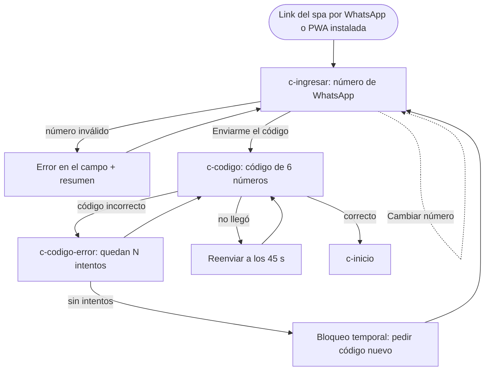
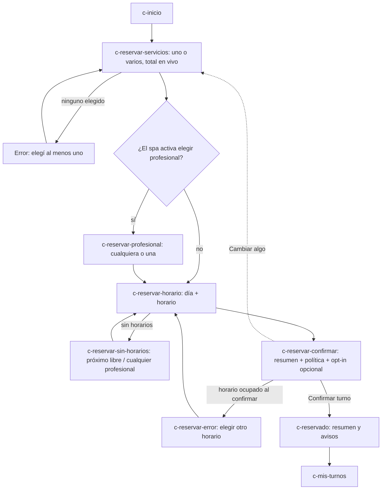
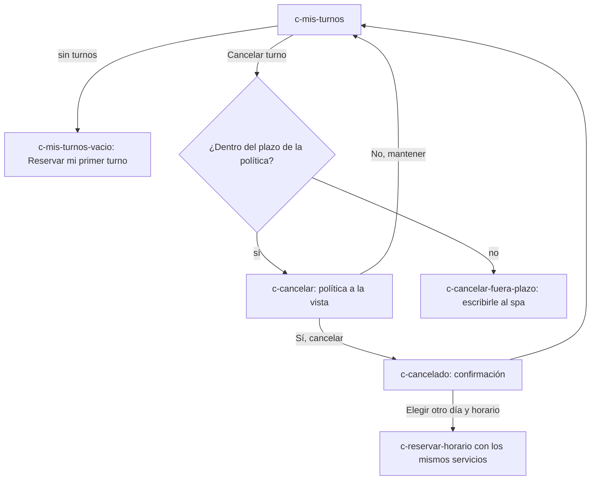
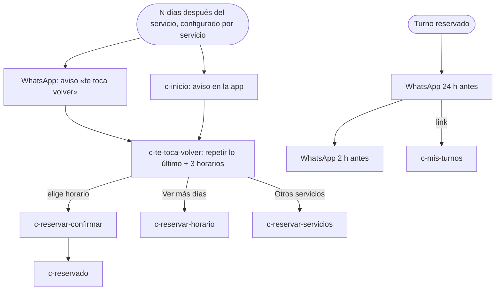
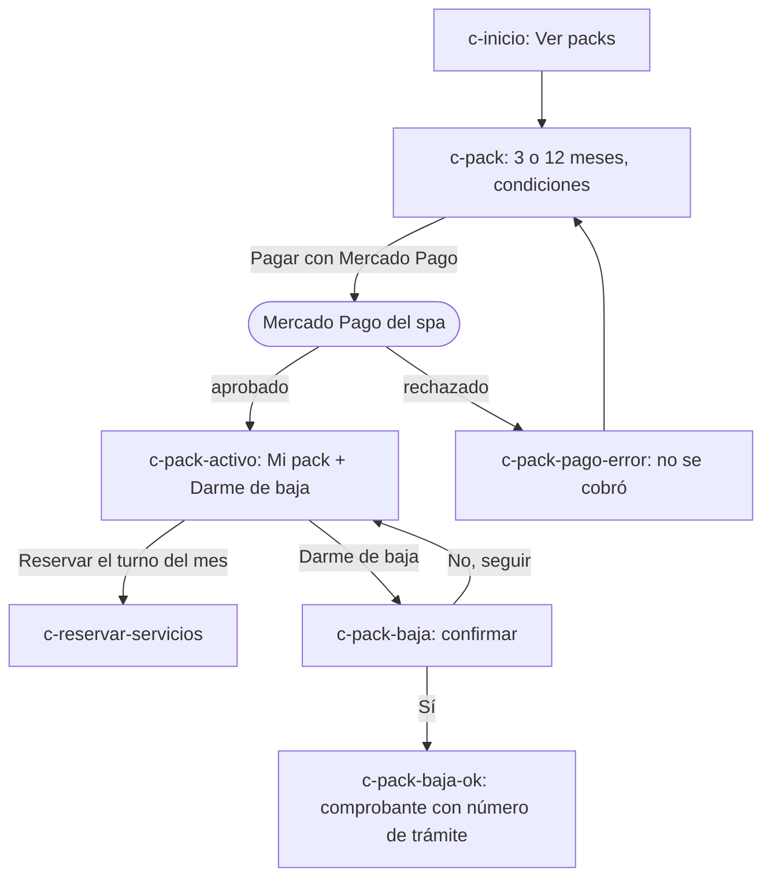
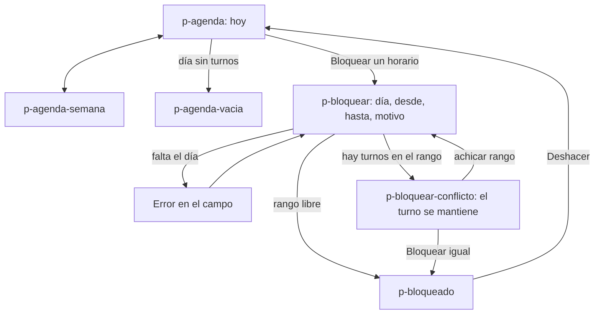
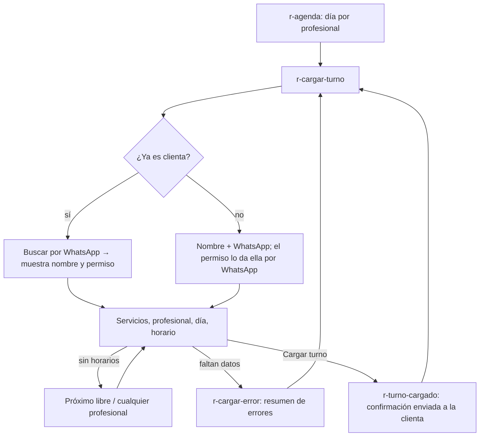
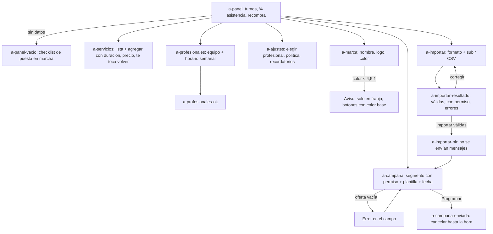

# Flujos · spa-reservas-mvp (Roadmap B)

Casos de uso provisorios (CU-xx) definidos en [README.md](README.md). Los nombres entre corchetes son
pantallas del prototipo (`prototypes/spa-reservas-mvp/<pantalla>.html`).

## CU-01 · Clienta ingresa con WhatsApp

## CU-02 · Clienta reserva

## CU-03 · Clienta cancela (sin reprogramar)

## CU-04 y CU-05 · Te toca volver y recordatorios

## CU-06 · Pack prepago (Fase 2)

## CU-07 y CU-08 · Profesional: agenda y bloqueo

## CU-09 · Recepción carga un turno

## CU-10 a CU-14 · Administradora

