# Flujos — Turnos para peluquería, MVP Hitos 1 y 2

Un diagrama por caso de uso del Hito 1 y del Hito 2 (desde [§ Hito 2](#hito-2)), con camino principal, errores, vacíos y salidas. Los nodos entre
corchetes llevan el nombre del archivo del prototipo (`prototypes/turnos-peluqueria-mvp/<archivo>.html`).
Criterios y reglas: [casos-de-uso.md](https://github.com/gm2dev/coop-agents-product/blob/po/turnos-peluqueria-mvp/initiatives/turnos-peluqueria-mvp/casos-de-uso.md).

Convención: rectángulo = pantalla o estado; rombo = decisión del sistema o del usuario; `-.->` = salida
alternativa.

## Vista general del cliente

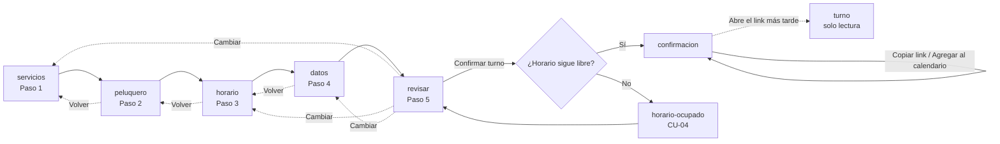

## CU-01 — Ver servicios

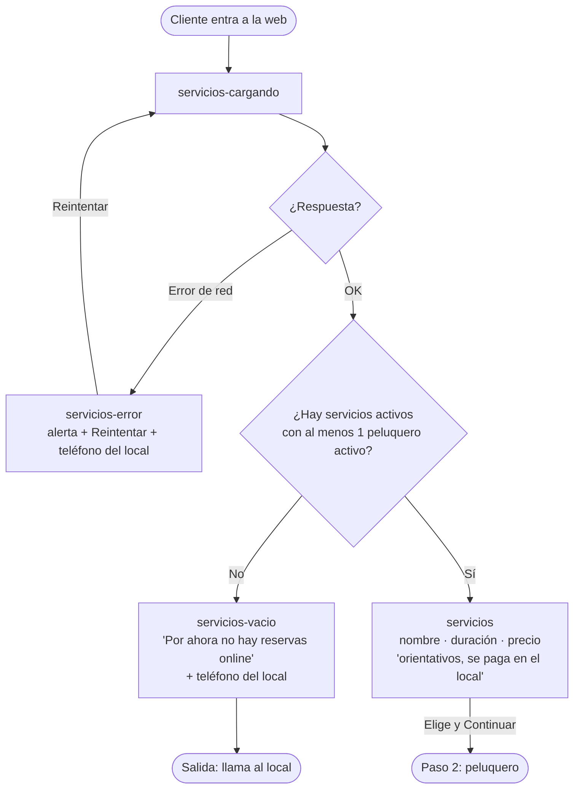

Inactivos y sin peluqueros no se listan (RN-15): no hay estado de UI para ellos del lado del cliente.

## CU-02 — Ver horarios libres

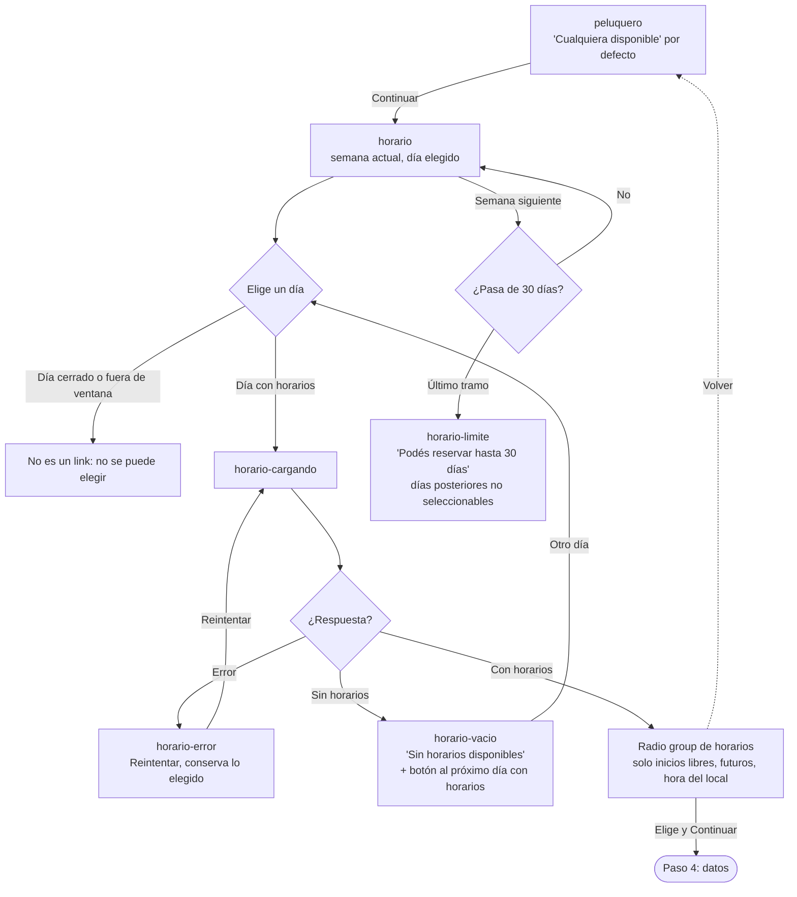

Con “Cualquiera disponible” los horarios son la unión sin repetidos de los peluqueros que hacen el servicio.

## CU-03 — Reservar un turno

## CU-04 — Reserva simultánea del mismo horario

La reasignación con “Cualquiera disponible” es transparente: el cliente solo ve el peluquero final en la confirmación.

## CU-05 — Confirmación, calendario y link privado

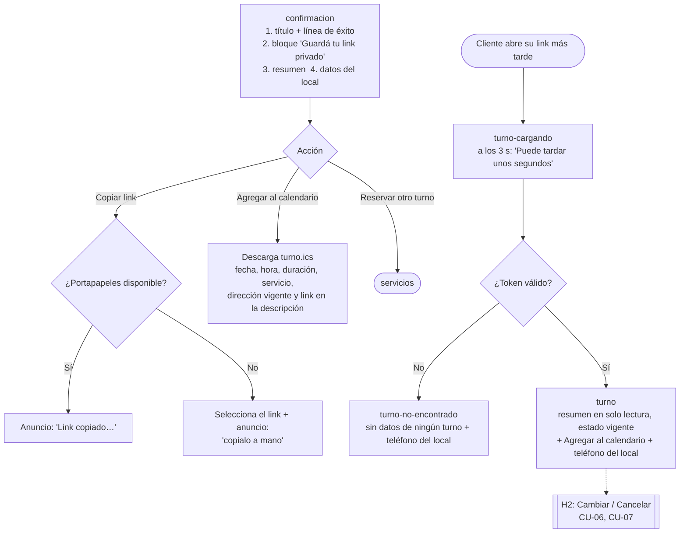

No hay ninguna rama de envío (email, SMS, WhatsApp): RN-12.

## CU-08 — Ingresar al panel

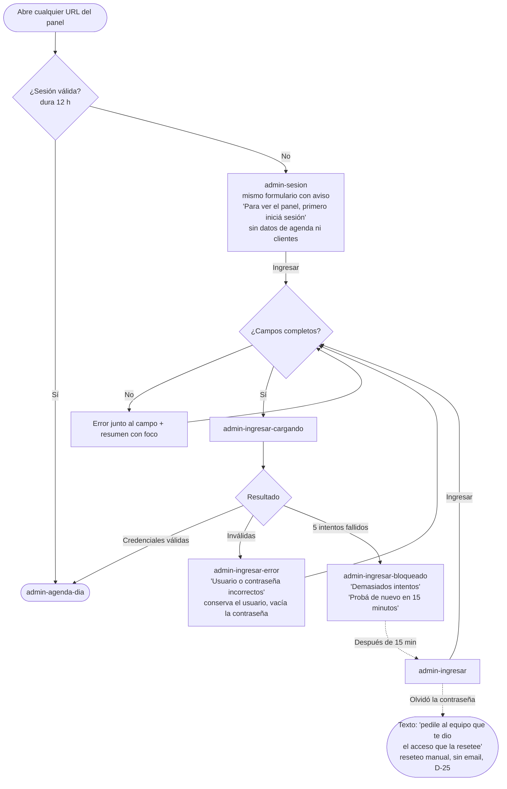

## CU-09 — Gestionar servicios

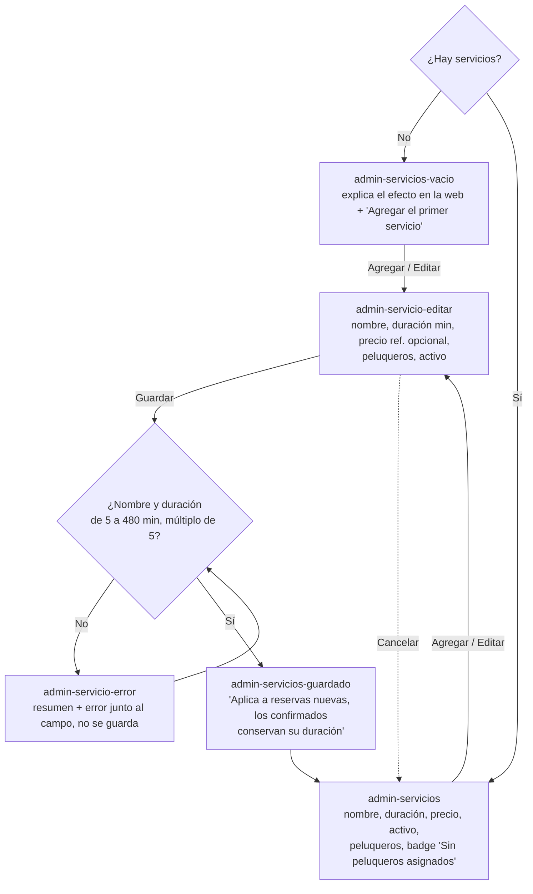

## CU-10 — Gestionar peluqueros y horario semanal

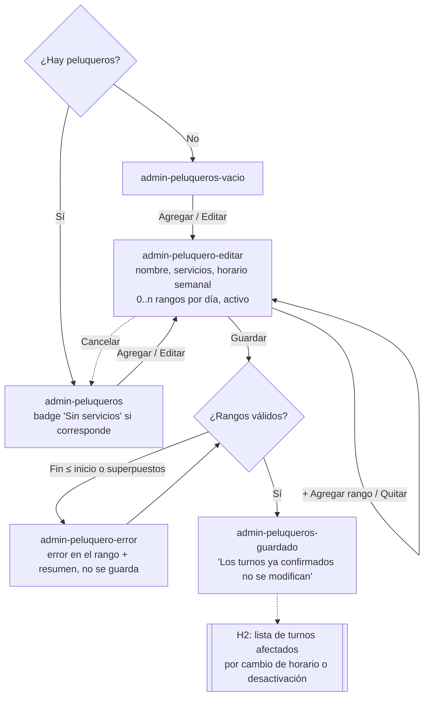

Un peluquero guardado sin servicios se guarda igual, con el aviso en la lista (CU-10, criterio 2).

## CU-12 — Ver la agenda

## CU-16 — Configurar datos del local

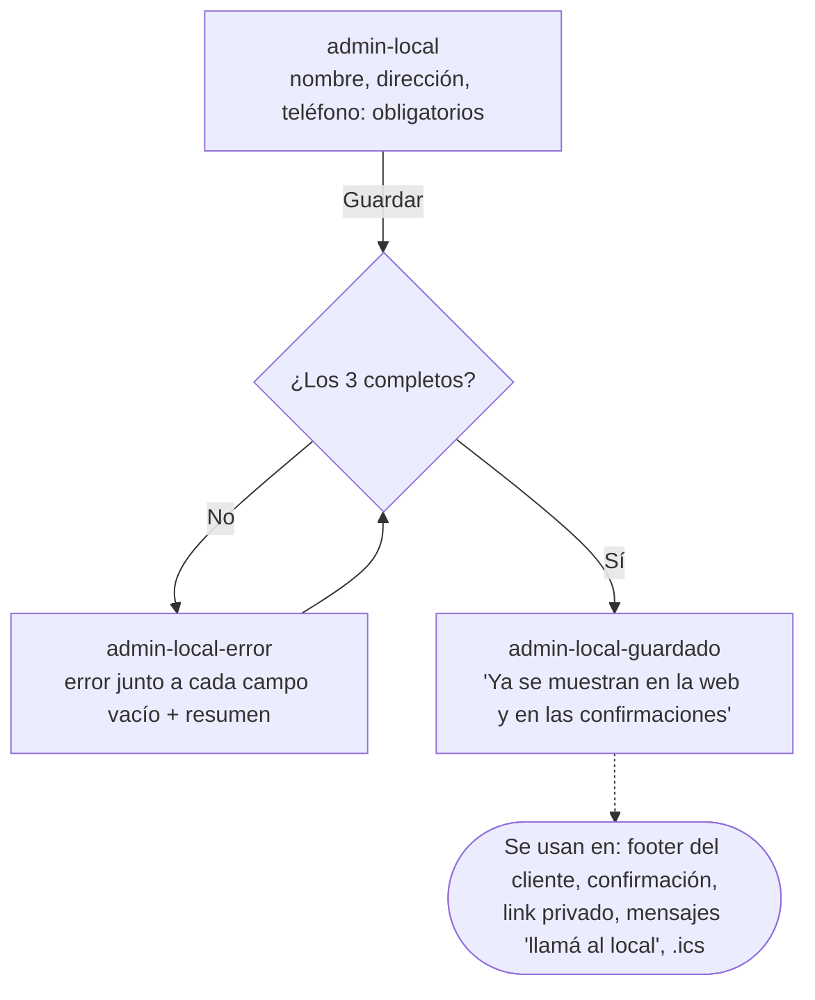

## Hito 2

### CU-05 (H2) — Estados del link privado

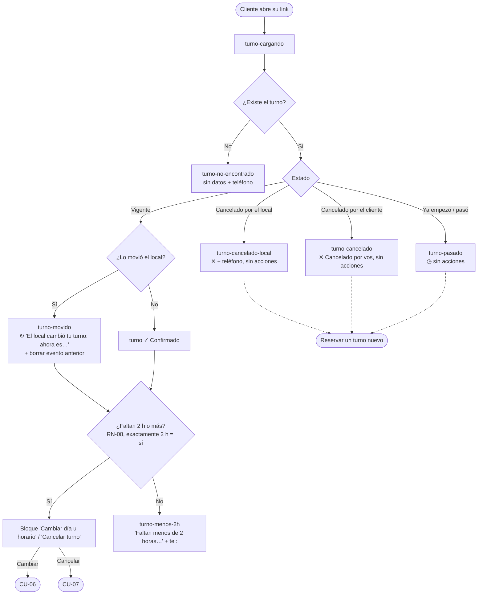

### CU-06 — Cambiar el turno desde el link

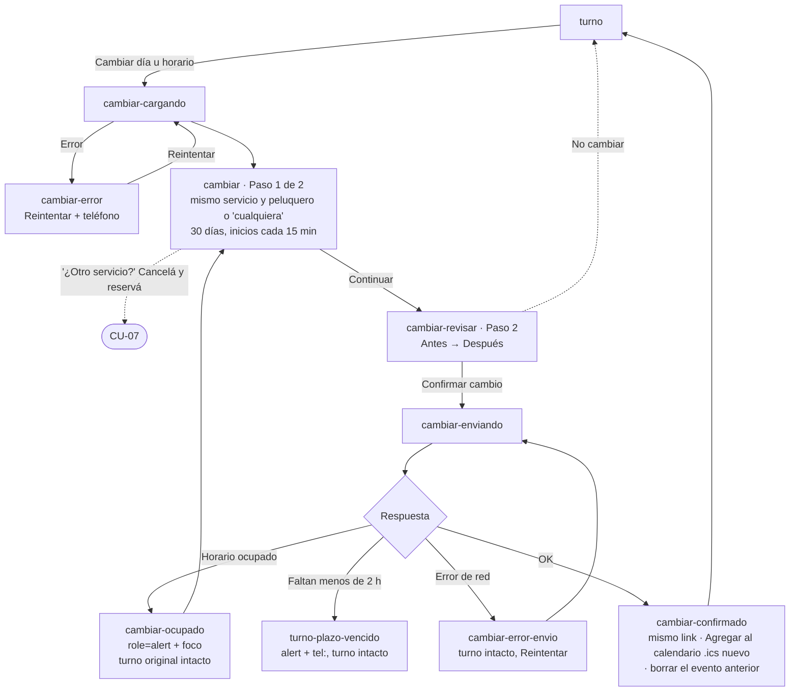

### CU-07 — Cancelar el turno desde el link

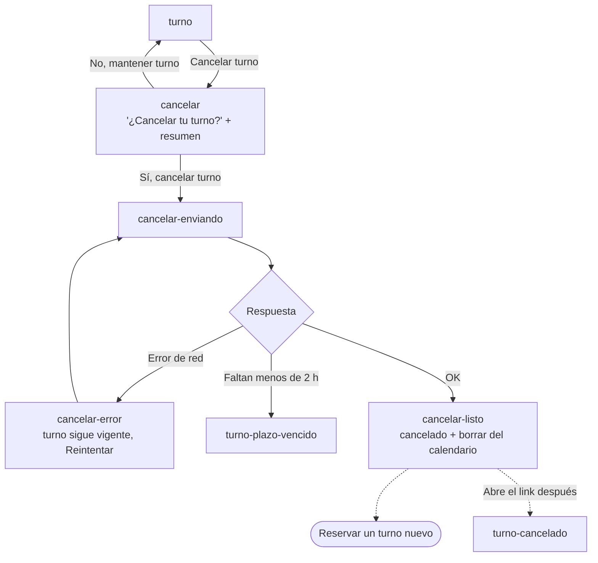

### CU-11 — Bloqueos

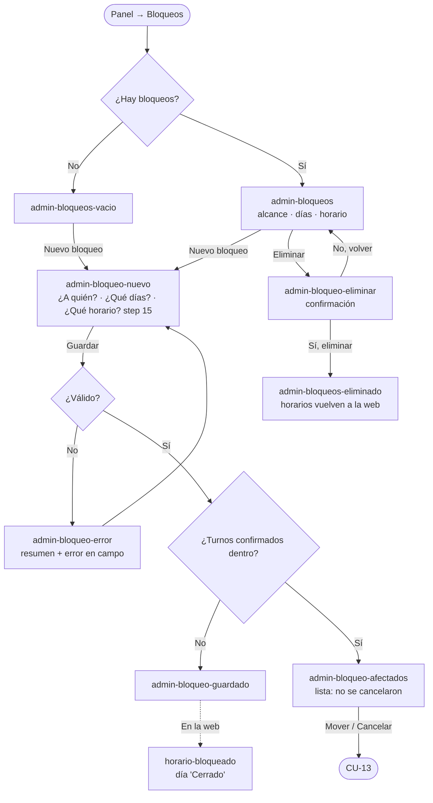

### CU-12 (H2) y CU-14 — Agenda operable y asistencia

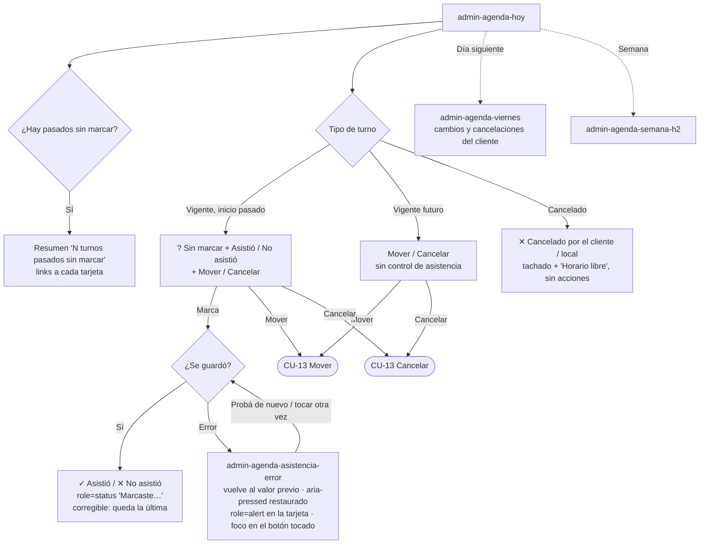

CU-14, error al guardar: la marca no se da por guardada hasta que responde el servidor. Si falla, el estado
vuelve al anterior (botones, `aria-pressed`, badge), se avisa con `role=alert` dentro de la misma tarjeta y el
foco no se mueve del botón tocado; el resumen “N sin marcar” no cambia. El contrato de la API lo define el Architect.

### CU-13 — Mover y cancelar desde el panel

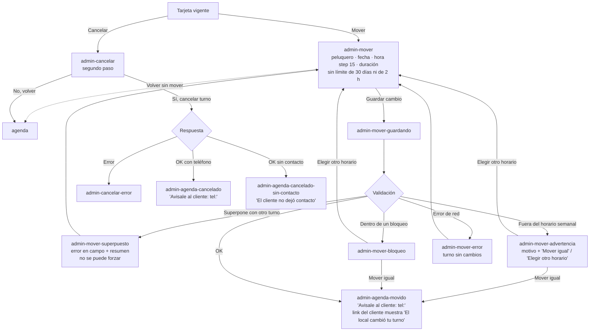

El panel no crea turnos (D-23) ni acceso al link privado (D-29); nada se envía al cliente (D-1).

### CU-10 (H2) — Turnos afectados por horario o desactivación

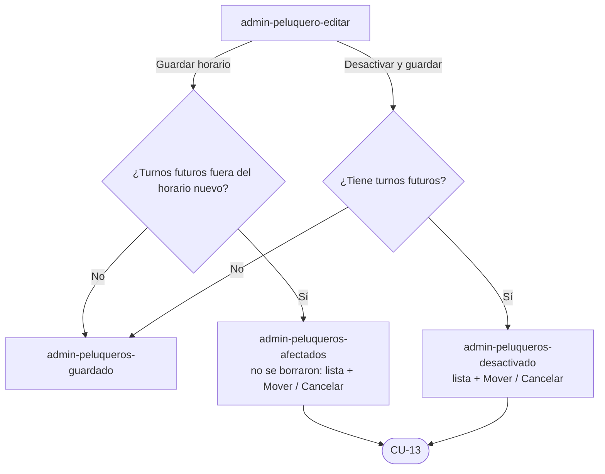
