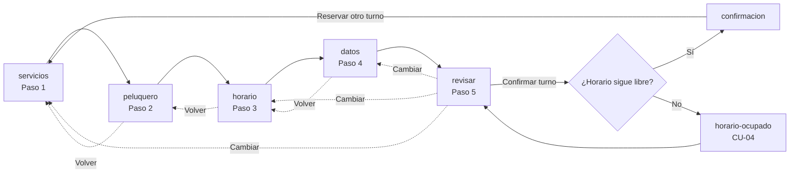
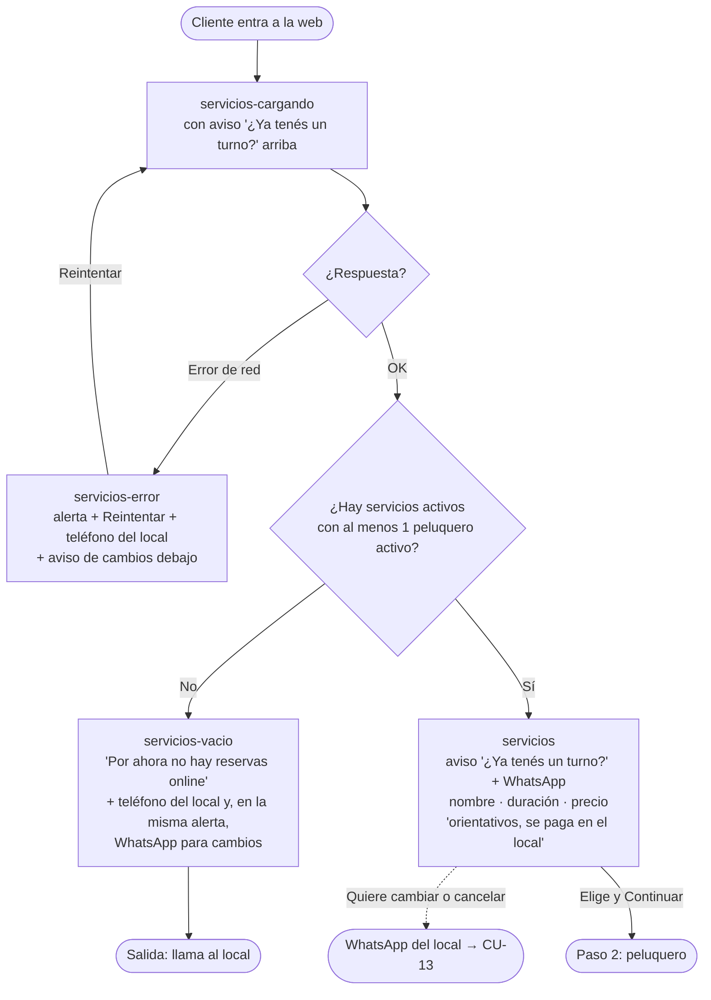
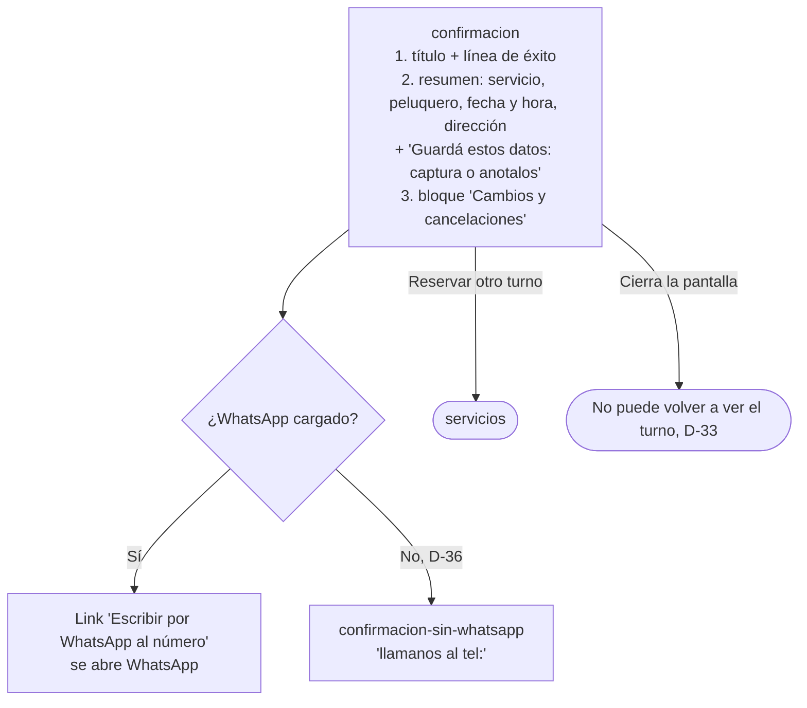
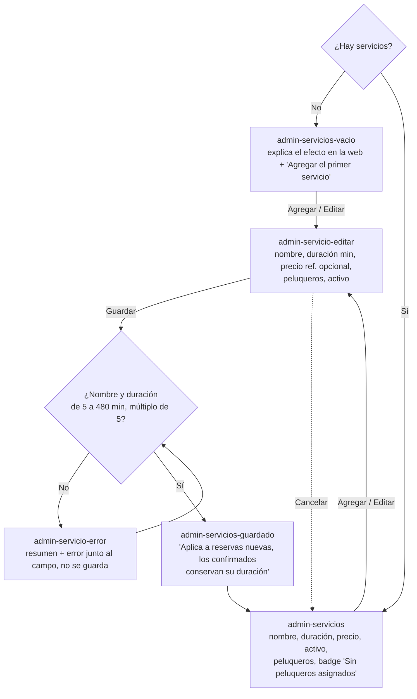
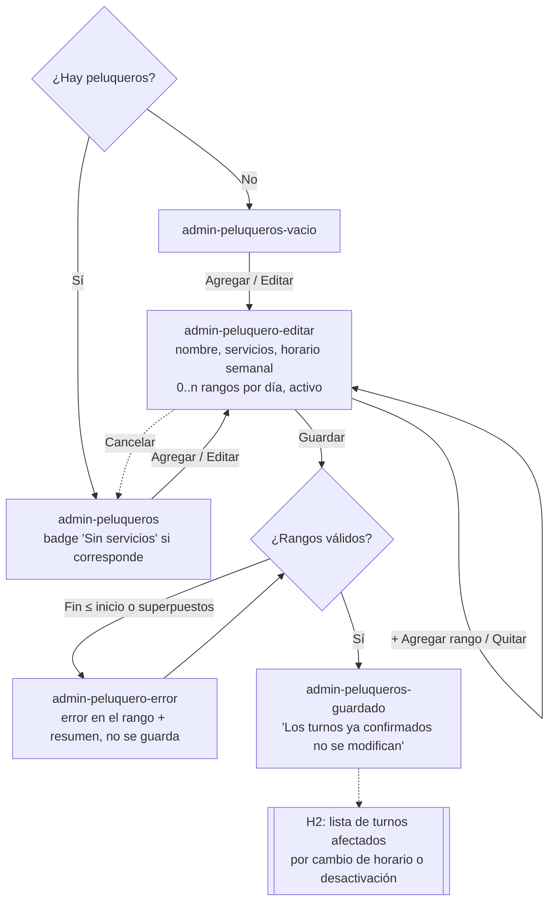
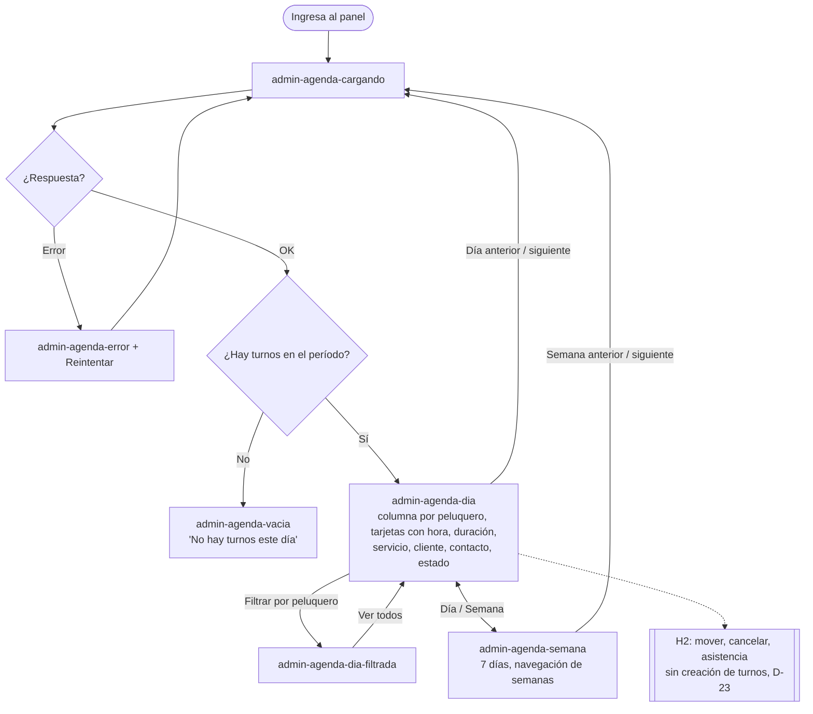
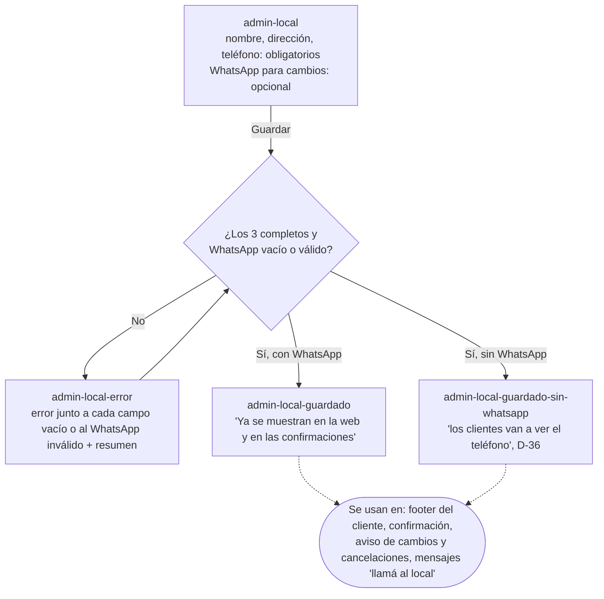
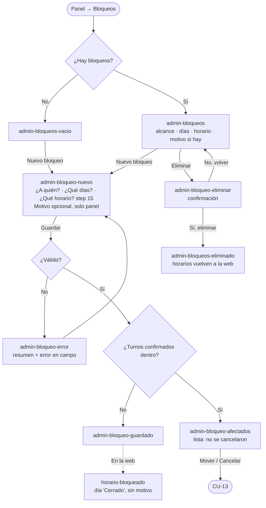
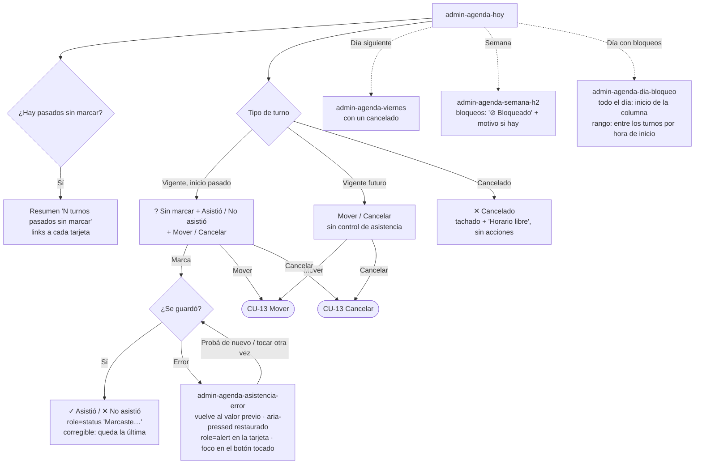
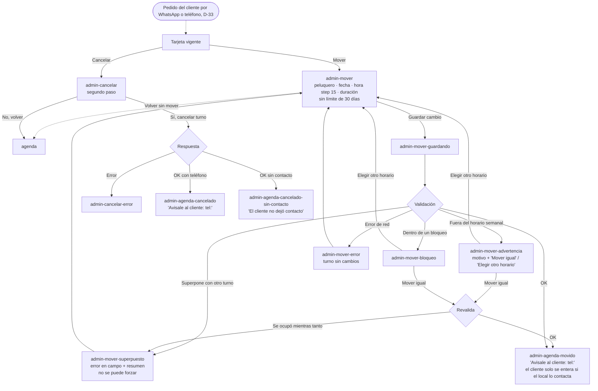

# Flujos — Turnos para peluquería, MVP Hitos 1 y 2

Un diagrama por caso de uso del Hito 1 y del Hito 2 (desde [§ Hito 2](#hito-2)), con camino principal, errores, vacíos y salidas. Los nodos entre
corchetes llevan el nombre del archivo del prototipo (`prototypes/turnos-peluqueria-mvp/<archivo>.html`).
Criterios y reglas: [casos-de-uso.md](https://github.com/gm2dev/coop-agents-product/blob/po/turnos-peluqueria-mvp/initiatives/turnos-peluqueria-mvp/casos-de-uso.md).

Convención: rectángulo = pantalla o estado; rombo = decisión del sistema o del usuario; `-.->` = salida
alternativa.

## Vista general del cliente



Desde v0.7 (D-33, D-34) no hay link privado, “Agregar al calendario” ni cambio o cancelación por el cliente:
después de cerrar la confirmación, la web no vuelve a mostrar el turno. El aviso de contacto para cambios
(DD-37) está en `servicios` (portada) y en `confirmacion`; en los pasos intermedios el contacto queda en el pie.

## Cliente quiere cambiar o cancelar su turno (D-33, RN-25)

```mermaid
flowchart TD
  need([Cliente con turno quiere cambiarlo o cancelarlo]) --> where{¿Dónde lo ve?}
  where -->|Entra a la web| s[servicios<br/>'¿Ya tenés un turno?' arriba de la lista]
  where -->|Todavía en la confirmación| c[confirmacion<br/>bloque 'Cambios y cancelaciones'<br/>debajo del resumen]
  s & c --> wa{¿El local cargó WhatsApp? CU-16}
  wa -->|Sí| link[Link 'Escribir por WhatsApp al número'<br/>abre wa.me con el número del local]
  wa -->|No, D-36| tel[Texto 'llamanos al teléfono'<br/>link tel:, sin WhatsApp]
  link --> chat([Le escribe al local por WhatsApp<br/>fuera del sistema, no es notificación: RN-12])
  tel --> call([Llama al local])
  chat & call --> admin[Admin en el panel: agenda → Mover / Cancelar<br/>CU-13]
  admin --> mv[admin-mover → admin-agenda-movido]
  admin --> cc[admin-cancelar → admin-agenda-cancelado]
  mv & cc --> reply([El local le responde al cliente por su cuenta<br/>el sistema no le envía nada, D-1, D-3])
```

## CU-01 — Ver servicios



Inactivos y sin peluqueros no se listan (RN-15): no hay estado de UI para ellos del lado del cliente.
Sin WhatsApp cargado (D-36), el aviso dice “llamanos al <teléfono>” (`servicios-sin-whatsapp`).

## CU-02 — Ver horarios libres


Con “Cualquiera disponible” los horarios son la unión sin repetidos de los peluqueros que hacen el servicio.

## CU-03 — Reservar un turno


## CU-04 — Reserva simultánea del mismo horario


La reasignación con “Cualquiera disponible” es transparente: el cliente solo ve el peluquero final en la confirmación.

## CU-05 — Ver la confirmación



No hay ninguna rama de envío (email, SMS, WhatsApp del sistema): RN-12. Sin link privado, calendario ni
Cambiar/Cancelar (D-33, D-34; CU-06 y CU-07 eliminados).

## CU-08 — Ingresar al panel


## CU-09 — Gestionar servicios



## CU-10 — Gestionar peluqueros y horario semanal



Un peluquero guardado sin servicios se guarda igual, con el aviso en la lista (CU-10, criterio 2).

## CU-12 — Ver la agenda



## CU-16 — Configurar datos del local

Validación del WhatsApp provisional (DD-38, pendiente de producto): `+` y código de país, 10 a 15 dígitos.



<a id="hito-2"></a>
## Hito 2

### CU-05 (H2), CU-06 y CU-07 — Eliminados (v0.7)

Los estados del link privado, cambiar y cancelar desde el link se eliminaron por D-33 (RN-07, RN-08, RN-09 y
RN-18 eliminadas). El camino que los reemplaza es [Cliente quiere cambiar o cancelar su turno](#cliente-quiere-cambiar-o-cancelar-su-turno-d-33-rn-25).

### CU-11 — Bloqueos



El motivo (D-30, RN-22) es opcional: vacío no da error y no se muestra nada. Se ve en la lista de bloqueos y en la agenda (DD-36); el cliente nunca lo ve. En la agenda, un bloqueo de todo el día va al inicio de la columna del peluquero (o de todas, si es del local) o en el día de la semana; uno de rango horario va entre los turnos según su hora de inicio, con el rango visible, sin ocultar los turnos confirmados que caigan dentro (`admin-agenda-dia-bloqueo`).

### CU-12 (H2) y CU-14 — Agenda operable y asistencia



CU-14, error al guardar: la marca no se da por guardada hasta que responde el servidor. Si falla, el estado
vuelve al anterior (botones, `aria-pressed`, badge), se avisa con `role=alert` dentro de la misma tarjeta y el
foco no se mueve del botón tocado; el resumen “N sin marcar” no cambia. El Architect confirmó que es implementable tal cual (P-D13).

### CU-13 — Mover y cancelar desde el panel



El servidor valida todo de una vez (P-D12, Architect): la superposición gana y no trae advertencias; fuera de horario y bloqueo llegan juntos en una sola advertencia; “Mover igual” revalida antes de guardar.

El panel no crea turnos (D-23, D-35); nada se envía al cliente (D-1). Si el pedido llegó por WhatsApp, el local le responde por ahí.

### CU-10 (H2) — Turnos afectados por horario o desactivación


