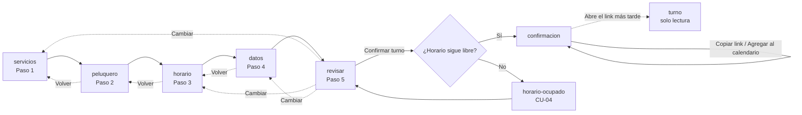
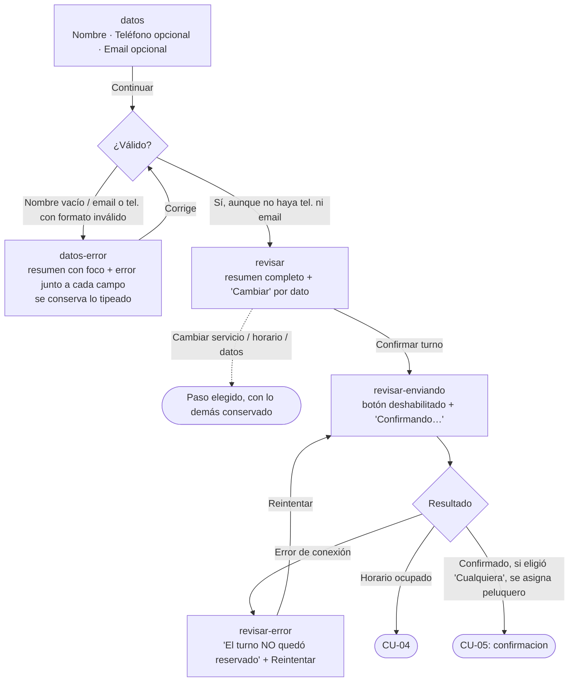
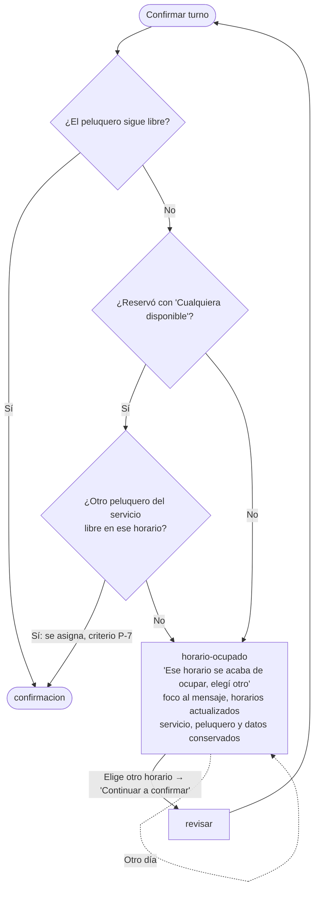
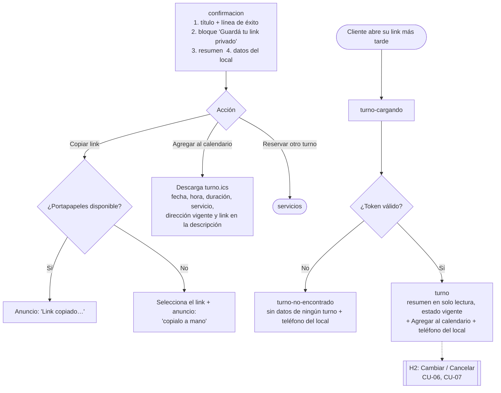
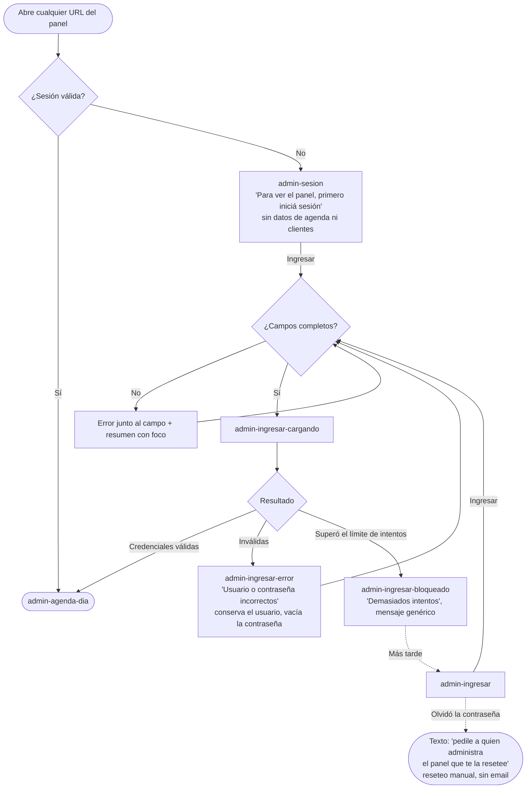
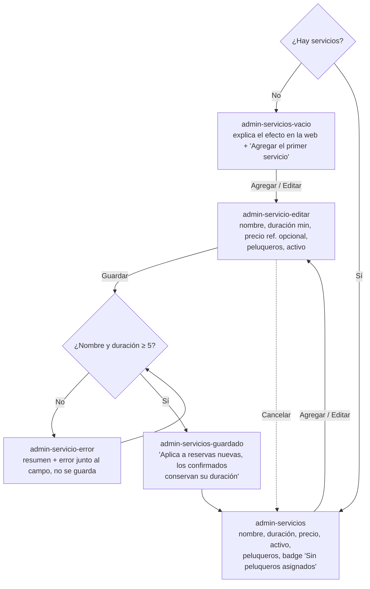
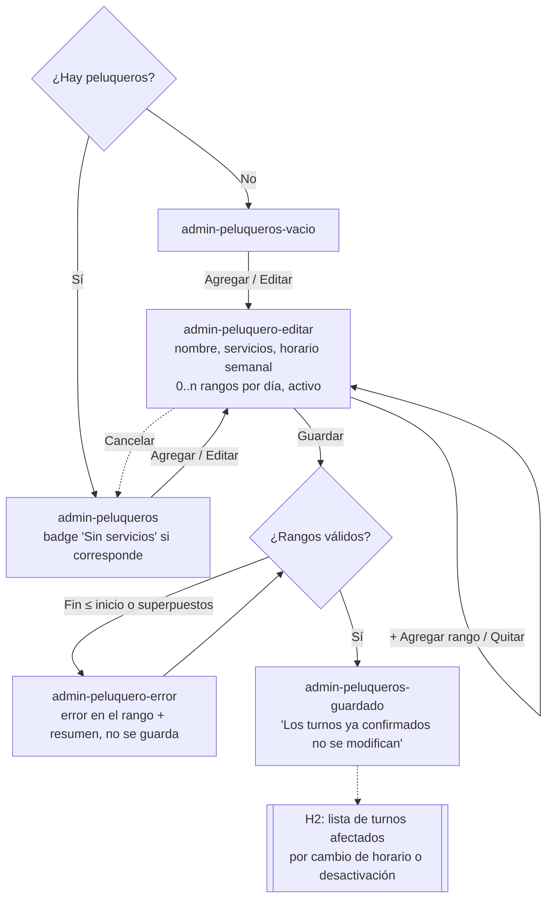
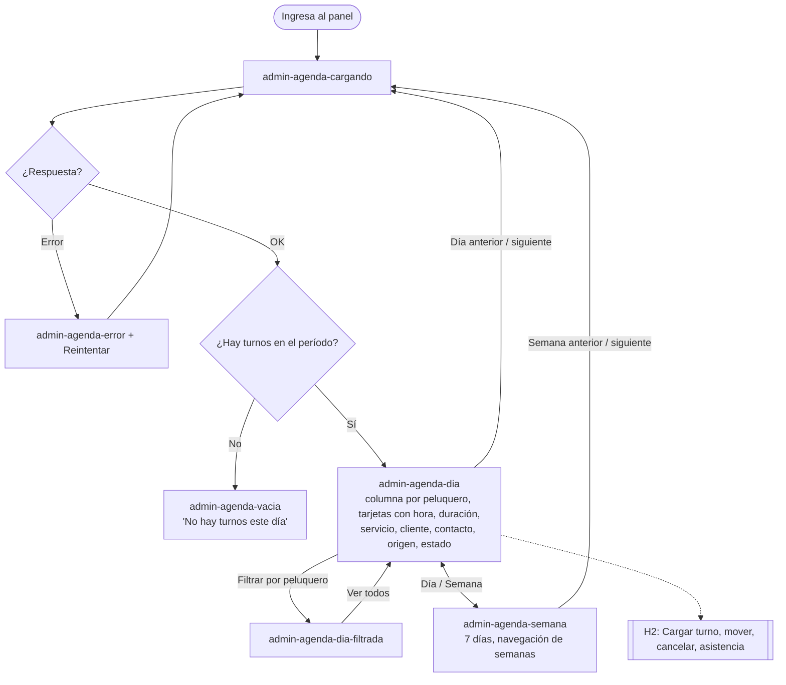

# Flujos — Turnos para peluquería, MVP Hito 1

Un diagrama por caso de uso del Hito 1, con camino principal, errores, vacíos y salidas. Los nodos entre
corchetes llevan el nombre del archivo del prototipo (`prototypes/turnos-peluqueria-mvp/<archivo>.html`).
Criterios y reglas: [casos-de-uso.md](https://github.com/gm2dev/coop-agents-product/blob/po/turnos-peluqueria-mvp/initiatives/turnos-peluqueria-mvp/casos-de-uso.md).

Convención: rectángulo = pantalla o estado; rombo = decisión del sistema o del usuario; `-.->` = salida
alternativa. Los nodos `H2` marcan dónde se engancha algo que se diseña después.

## Vista general del cliente

## CU-01 — Ver servicios

Inactivos y sin peluqueros no se listan (RN-15): no hay estado de UI para ellos del lado del cliente.

## CU-02 — Ver horarios libres

Con “Cualquiera disponible” los horarios son la unión sin repetidos de los peluqueros que hacen el servicio.

## CU-03 — Reservar un turno

## CU-04 — Reserva simultánea del mismo horario

La reasignación con “Cualquiera disponible” es transparente: el cliente solo ve el peluquero final en la confirmación.

## CU-05 — Confirmación, calendario y link privado

No hay ninguna rama de envío (email, SMS, WhatsApp): RN-12.

## CU-08 — Ingresar al panel

## CU-09 — Gestionar servicios

## CU-10 — Gestionar peluqueros y horario semanal

Un peluquero guardado sin servicios se guarda igual, con el aviso en la lista (CU-10, criterio 2).

## CU-12 — Ver la agenda

## CU-16 — Configurar datos del local

