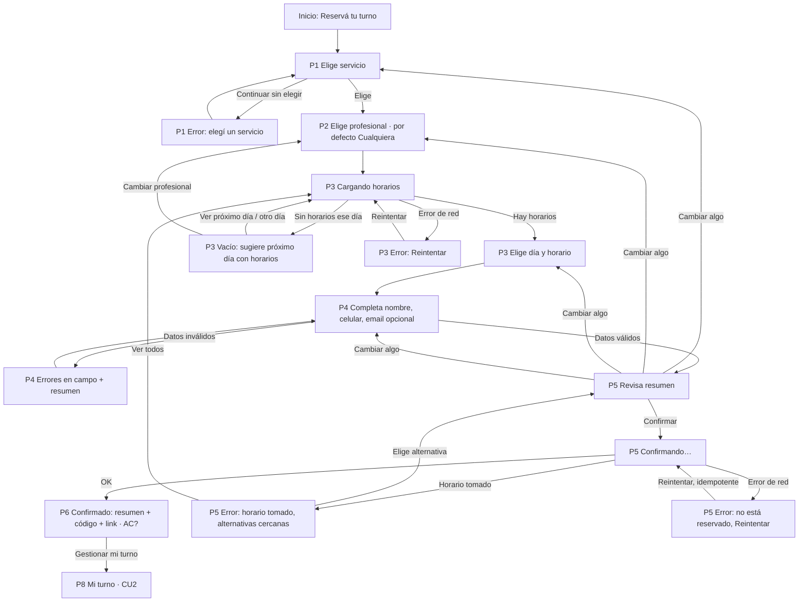
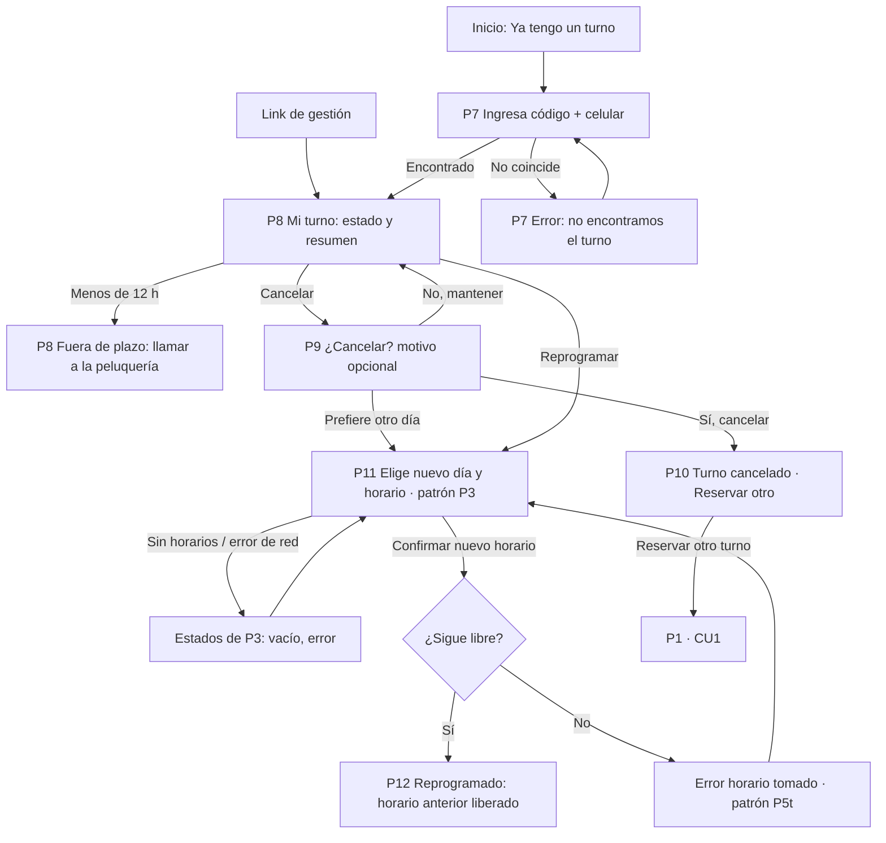
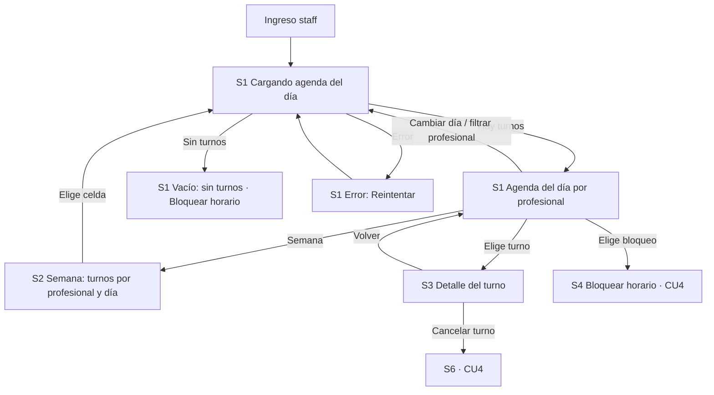
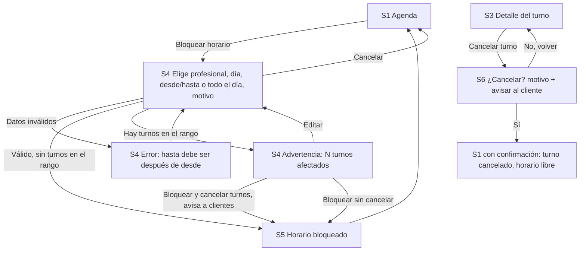

# Flujos — Turnos para peluquería (borrador v0)

Casos de uso **tentativos** (ver [README](README.md)). IDs de pantalla: `P*` cliente, `S*` staff;
se usan igual en [spec.md](spec.md) y en el prototipo. Los criterios de aceptación oficiales todavía
no existen: donde dice `AC?` hay que mapear cuando el PO los publique.

## CU1 — Cliente reserva un turno

Entrada: link público de la peluquería · Actor: cliente sin cuenta · Fin: turno confirmado con código y link de gestión.

| Nodo | Notas |
|---|---|
| P1e | Error sobre el grupo de radios + alerta con link al grupo. |
| P2 | Opcional: «Cualquiera disponible» preseleccionado, se puede continuar directo. |
| P3v | Nunca un callejón sin salida: próximo día con horarios, otro día o cambiar profesional. |
| P5t | Conserva datos; ofrece horarios más cercanos del mismo día. |
| P5x | Aclara que el turno **no** quedó reservado; reintentar no duplica (supuesto técnico, Q10). |

## CU2 — Cliente consulta, cancela o reprograma

Entrada: link del mensaje de confirmación (directo a P8) o «Ya tengo un turno» (P7) · Fin: turno consultado, cancelado o reprogramado.

## CU3 — Staff ve la agenda

Entrada: acceso del staff (S10, fuera de alcance) · Fin: el staff conoce los turnos del día/semana.

## CU4 — Staff bloquea horarios y cancela turnos

## Cobertura de estados

| Estado | Dónde |
|---|---|
| Carga | P3 (cargando horarios), P5 (confirmando), S1 (cargando agenda) |
| Vacío | P3 (sin horarios ese día), S1 (sin turnos) |
| Error: horario tomado | P5 (y P11 reutiliza el patrón) |
| Error de red | P3, P5, S1 |
| Validación de formulario | P1, P4, P7, S4 |
| Éxito | P6, P10, P12, S5, S1 tras cancelar |
| Fuera de plazo | P8 |
