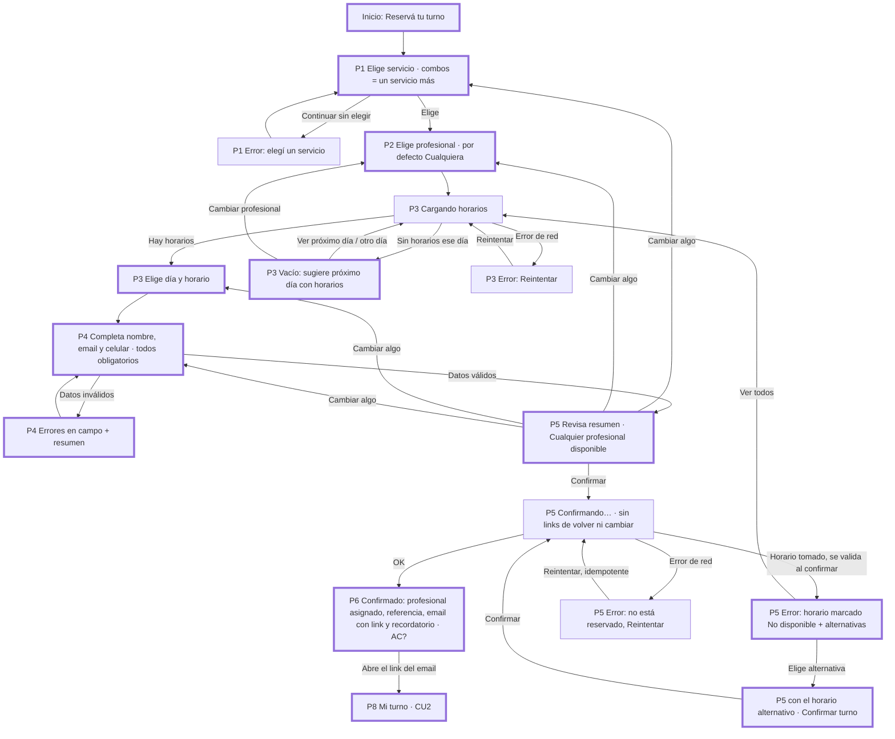
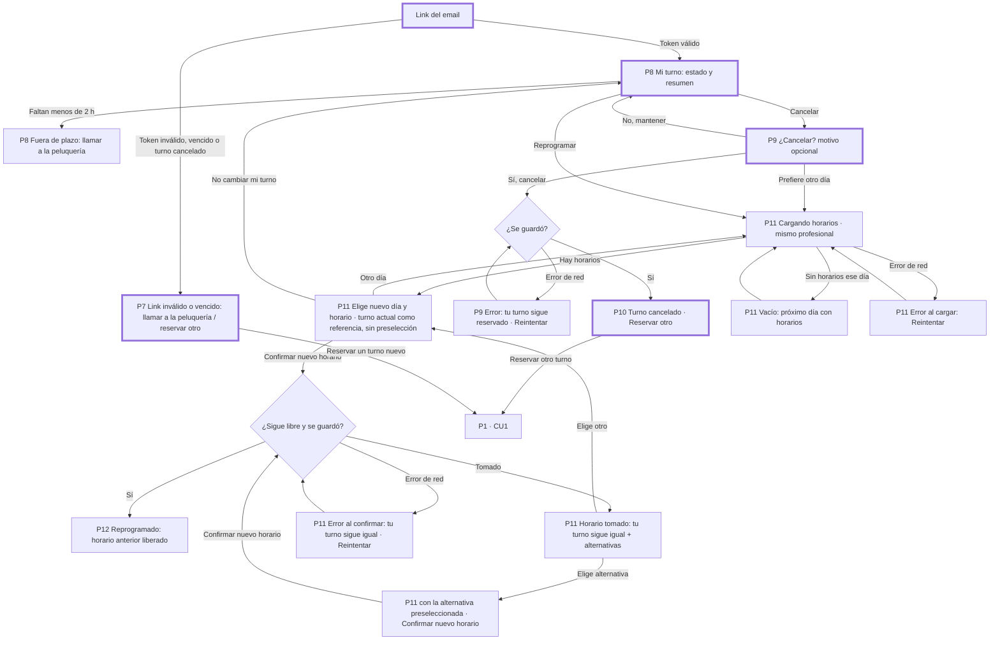
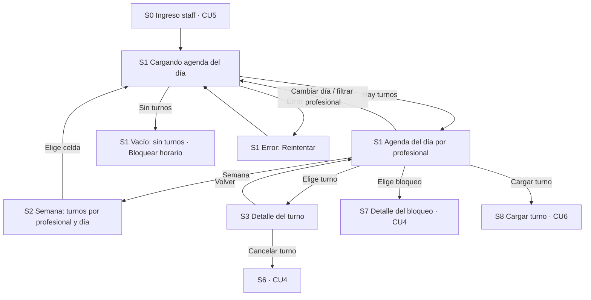
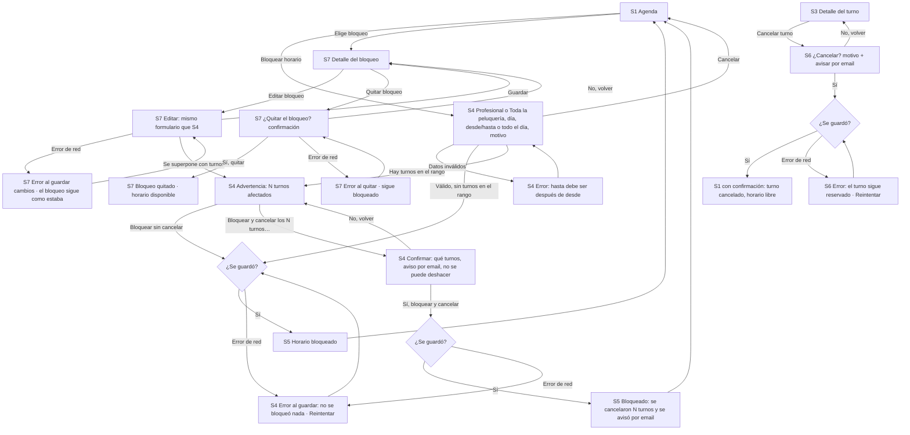
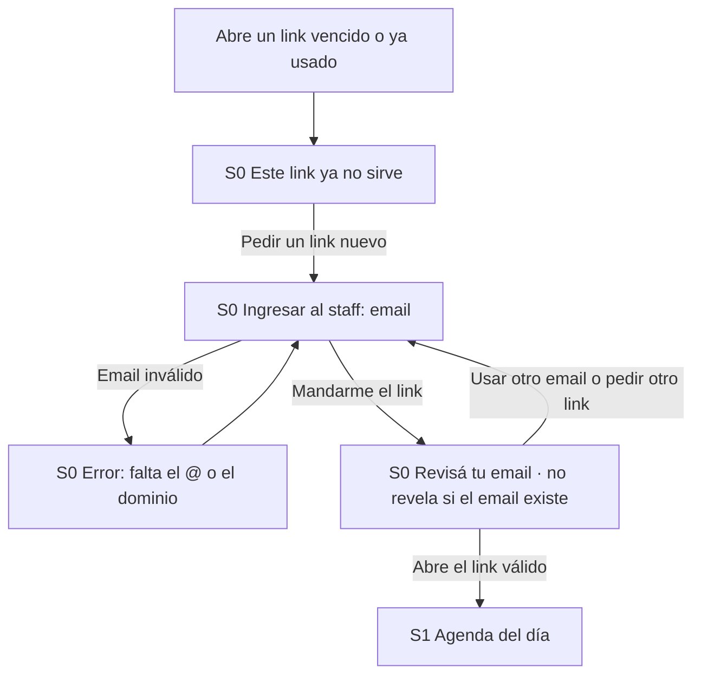
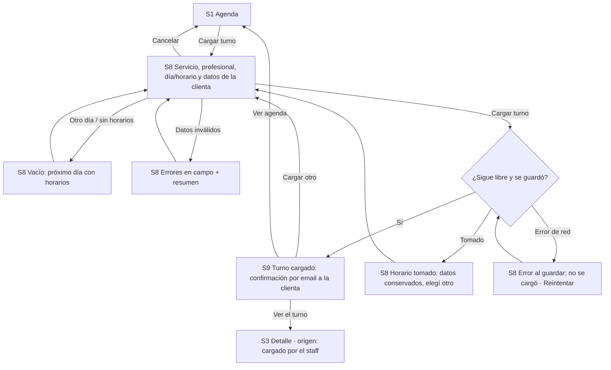

# Flujos — Turnos para peluquería (v0.2)

Casos de uso **tentativos** (ver [README](README.md)). IDs de pantalla: `P*` cliente, `S*` staff;
se usan igual en [spec.md](spec.md) y en el prototipo. Los nodos con clase `demo` (borde grueso) son
los del [recorrido de demo del MVP](README.md#alcance-de-la-demo-mvp); ver la tabla de abajo. Donde dice `AC?` hay que mapear cuando el PO
publique los criterios de aceptación.

## CU1 — Cliente reserva un turno

Entrada: link público de la peluquería · Actor: cliente sin cuenta · Fin: turno confirmado y email con el link de gestión.

| Nodo | Notas |
|---|---|
| P1e | Error sobre el grupo de radios + alerta con link al grupo. |
| P2 | Opcional: «Cualquiera disponible» preseleccionado, se puede continuar directo. |
| P3v | Nunca un callejón sin salida: próximo día con horarios, otro día o cambiar profesional. |
| P4 | Email y celular obligatorios (CPO). Bajo celular: «La peluquería lo usa solo para llamarte si tiene que cancelar o mover tu turno.» |
| P5 | Con «cualquiera» no se muestra un asignado (se asigna al confirmar, S8); P6 muestra quién quedó. |
| P5t | No se retiene el horario (Architect, Q10): se valida al confirmar. Conserva datos; el horario elegido se marca «No disponible» y se ofrecen los más cercanos. Sin aviso de tiempo restante. |
| P5a | `revisar-alternativa.html` (16:15) / `revisar-alternativa-1700.html`: mismo resumen con el horario nuevo y un aviso; no confirma sola. |
| P5x | Aclara que el turno **no** quedó reservado; reintentar no duplica. |

## CU2 — Cliente consulta, cancela o reprograma

Entrada: **solo** el link del email de confirmación (token largo que vence cuando pasa el turno) · Fin:
turno consultado, cancelado o reprogramado. No hay entrada por código + celular.

| Nodo | Notas |
|---|---|
| P7 | Antes era el formulario código + celular; ahora es la salida del link inválido (CPO + Architect, S2/Q11). Pregunta abierta Q14: «Reenviarme el link por email». |
| P11a | `reprogramar-alternativa.html` (17:00) / `reprogramar-alternativa-1830.html`: la alternativa del Alert preselecciona el horario; reprograma recién con «Confirmar nuevo horario». |
| P11 | Pantallas propias de CU2 (`reprogramar*.html`), con «← Tu turno» y «No cambiar mi turno»: nunca saca al usuario a CU1. Solo cambia día/horario (Q7, decisión CDO v0). |
| Todas | Pie «¿Necesitás ayuda?» con el teléfono de la peluquería (3.2.6). |

## CU3 — Staff ve la agenda

Entrada: S0 ingreso con link mágico (CU5) · Fin: el staff conoce los turnos del día/semana.

## CU4 — Staff bloquea horarios y cancela turnos

| Nodo | Notas |
|---|---|
| S4 | Feriado = «Toda la peluquería» + «Todo el día» + motivo «Feriado» (Q12). Zona horaria fija del local. |
| S4c | Ya no existe un nodo «Editar» desde la advertencia: el formulario sigue en la misma pantalla y se corrige ahí. Editar existe en S7 (bloqueo ya creado). |
| S4k | Paso destructivo explícito: lista de turnos con email de cada clienta, motivo para el aviso, botón danger. |
| S7e | Si al editar el nuevo período se superpone con turnos, vuelve a la advertencia S4c (en el prototipo se documenta, no se dibuja otra pantalla). |

## CU5 — Staff ingresa con link mágico

Decisión Architect + CPO (Q13): email + link mágico, un solo rol, todos ven todas las agendas.

## CU6 — Staff carga un turno a mano

Decisión CPO (Q8): incluido en el MVP. Reutiliza DayPicker, SlotPicker, campos y validaciones de CU1.

## Nodos del recorrido de demo (MVP)

| Flujo | En la demo | Después del MVP |
|---|---|---|
| CU1 | A, P1, P2, P3, P3v, P4, P4e, P5, P5t, P5a, P6 | — (P3L/P3x, P5c, P5x quedan como estados de soporte) |
| CU2 | L, P8, P7, P9, P10 | P11*, P12 (reprogramar) |
| CU5 | S0, enviado | — |
| CU3 | S1 (día), S3 | S2 (semana), S3 de turno cargado a mano |
| CU4 | S4 (incl. feriado), S5 | conflicto con turnos y confirmar cancelación, S5 con cancelados, S6, S7 |
| CU6 | — | todo (S8, S9) |

## Cobertura de estados

| Estado | Dónde |
|---|---|
| Carga | P3, P11 (cargando horarios), P5 (confirmando), S1 (cargando agenda) |
| Vacío | P3, P11, S8 (sin horarios ese día), S1 (sin turnos) |
| Error: horario tomado | P5, P11, S8 |
| Error de red al cargar | P3, P11, S1 |
| Error de red al guardar una acción | P5 (confirmar), P9 (cancelar), P11 (reprogramar), S4 (bloquear), S6 (cancelar desde staff), S7 (editar y quitar bloqueo), S8 (cargar turno) |
| Validación de formulario | P1, P4, S0, S4, S8 |
| Confirmación de acción destructiva | P9, S4 (cancelar turnos al bloquear), S6, S7 (quitar bloqueo) |
| Éxito | P6, P10, P12, S0 (link enviado), S5 (con y sin turnos cancelados), S7 (quitado), S9, S1 tras cancelar |
| Fuera de plazo | P8 |
| Link inválido o vencido | P7 (cliente), S0 (staff) |
